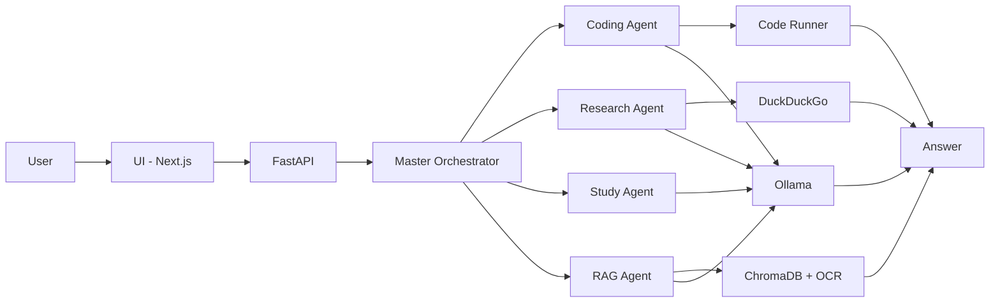
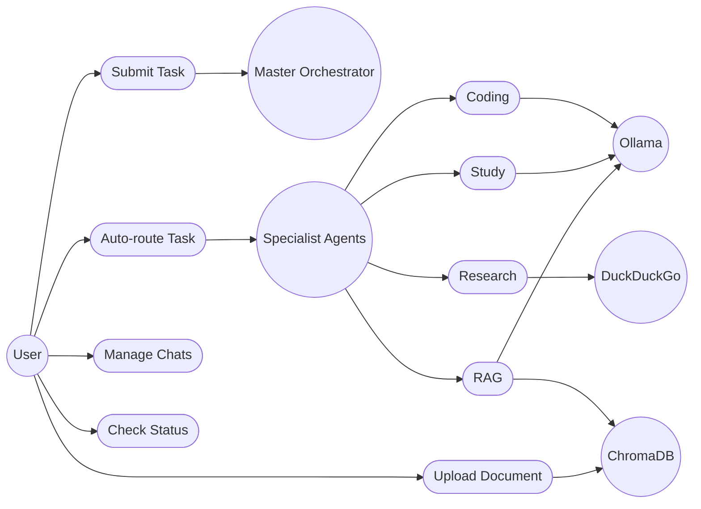
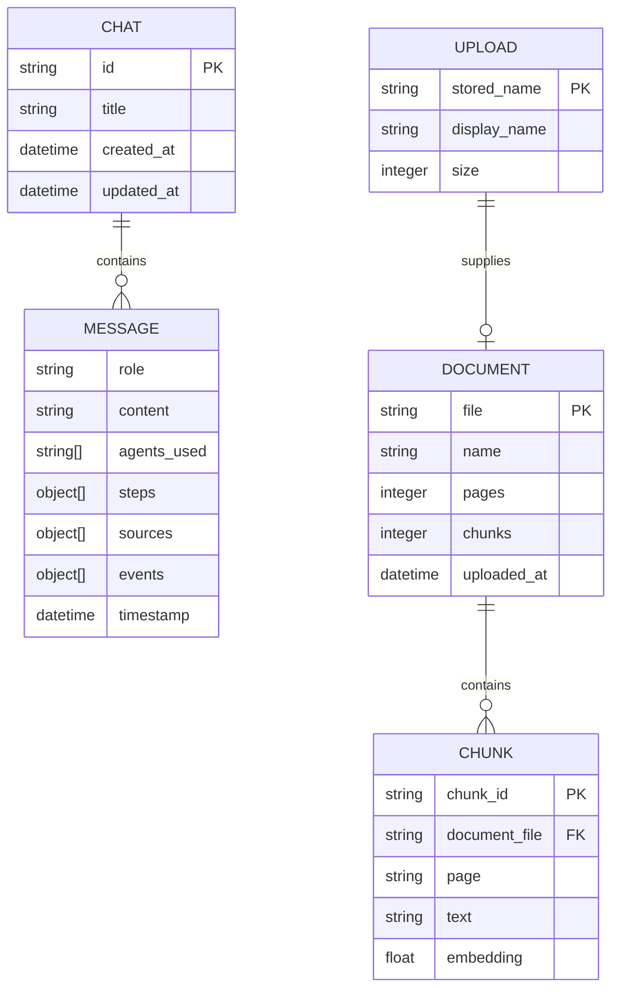
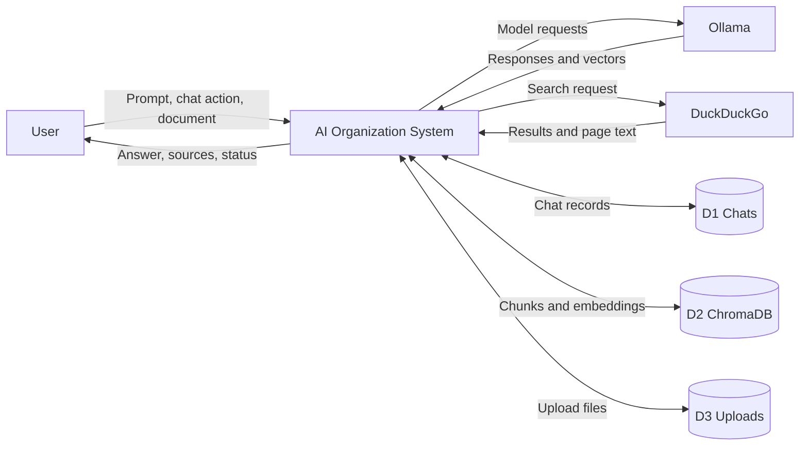
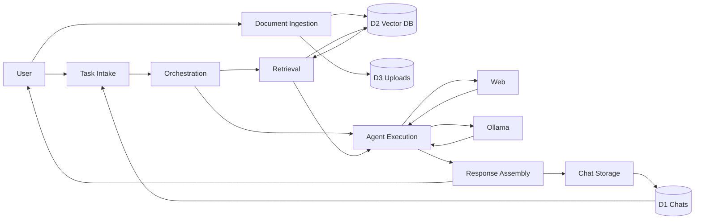
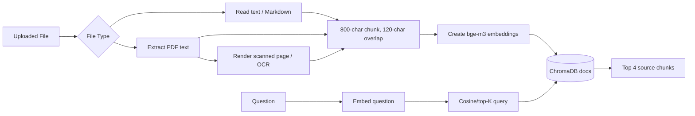
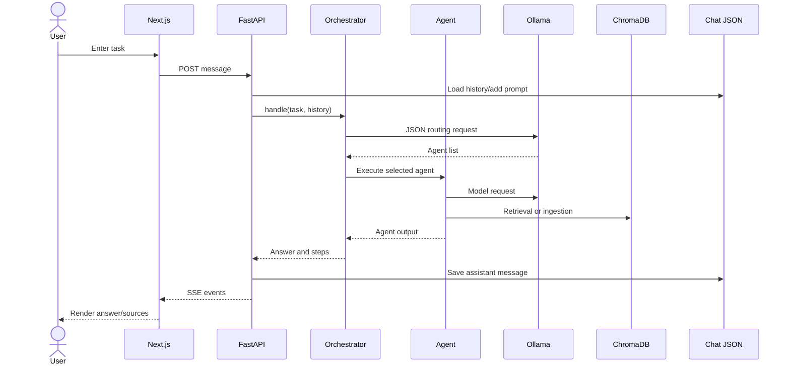

# AI Organization: Local-First Multi-Agent Project Report

## Table of Contents

1. [INTRODUCTION](#1-introduction)
2. [OBJECTIVES](#2-objectives)
3. [EXISTING SYSTEM](#3-existing-system)
4. [PROPOSED SYSTEM](#4-proposed-system)
5. [SCOPE OF THE PROJECT](#5-scope-of-the-project)
6. [SYSTEM REQUIREMENTS](#6-system-requirements)
7. [SYSTEM ANALYSIS](#7-system-analysis)
8. [USE CASE DIAGRAM](#8-use-case-diagram)
9. [USE CASE LISTING (PRE AND POST CONDITIONS)](#9-use-case-listing-pre-and-post-conditions)
10. [ER DIAGRAM](#10-er-diagram)
11. [DATA FLOW DIAGRAM (DFD)](#11-data-flow-diagram-dfd)
12. [MODULE DESCRIPTION](#12-module-description)
13. [IMPLEMENTATION](#13-implementation)
14. [GALLERY](#14-gallery)
15. [TESTING](#15-testing)
16. [FUTURE SCOPE](#16-future-scope)
17. [CONCLUSION](#17-conclusion)

[REFERENCES](#references)

# 1. INTRODUCTION

AI Organization is a local-first multi-agent AI platform that provides a virtual organization of specialist agents on a laptop. Its Master Orchestrator accepts a user task, routes it to one or more departments, and returns a combined answer. The implemented departments are Coding, Research, Study, and RAG. The project reduces dependence on paid cloud APIs and keeps chat, uploaded documents, and generated embeddings on the local device.

The system uses Ollama for language generation and embeddings. The repository includes both a Next.js/FastAPI web application and secondary terminal and Streamlit interfaces. The Next.js interface is the primary web UI. The backend communicates with Ollama, ChromaDB, DuckDuckGo/DDGS search, document readers, OCR, and a limited code execution helper.

The platform solves four practical problems: cloud subscription and connectivity dependence, repeated switching between separate coding, research, study, and document tools, weak routing among general-purpose assistants, and lack of visible sources for document answers. It does not guarantee that all model answers are accurate; 2B-3B parameter models and OCR remain subject to hallucination and extraction errors.

## 1.1 Project Status Summary

| Area | Verified status |
|---|---|
| Master orchestration | Implemented |
| Coding, research, study, RAG agents | Implemented |
| Ollama integration | Implemented and locally reachable |
| ChromaDB RAG | Implemented |
| PDF, text, Markdown, and image ingestion | Implemented |
| Scanned PDF and image OCR | Implemented through a vision model |
| Next.js web UI | Implemented; production build passed |
| FastAPI SSE backend | Implemented |
| Streamlit UI | Implemented |
| Terminal UI | Implemented |
| Cloud deployment | Not implemented |
| User authentication | Not implemented |
| Docker code sandbox | Not implemented |

# 2. OBJECTIVES

The main objective is to provide a private, low-cost virtual organization that performs common AI tasks locally and presents each result through a consistent interface.

1. **Local-first and private operation:** Keep chat, uploaded files, and vector records on the device by using JSON storage and local ChromaDB.
2. **Remove paid API dependence:** Use locally installed Ollama models instead of paid cloud model APIs.
3. **Automatic task routing:** The Master Orchestrator sends a task to one or more specialist agents using JSON model output plus keyword fallback.
4. **Multi-agent collaboration:** Selected agents receive shared context, and the final agent output becomes the answer for a single-agent or pipeline task.
5. **Document-grounded answers:** The RAG agent chunks documents, creates bge-m3 embeddings, retrieves nearest chunks, and asks the configured study model to answer from excerpts.
6. **OCR and document support:** PyMuPDF extracts text PDFs; low-text PDF pages are rendered and passed to qwen3-vl:2b; images and text files are supported.
7. **Hybrid and web-assisted workflows:** The orchestrator can combine RAG, research, and study agents in a pipeline. A separate explicit answer-mode selector is not implemented.
8. **Persistent chat and modern UI:** Chats are stored locally and can be opened, renamed, and deleted through the Next.js UI. Dark/light themes and text sizes are available.
9. **Low-resource operation:** Small 2B-3B models are configured, and Ollama is asked to disable thinking output for faster responses.

# 3. EXISTING SYSTEM

Common AI tools divide work into separate categories and usually transfer prompts or documents to external services. This creates cost, privacy, integration, and grounding concerns.

| System | Strengths | Limitations |
|---|---|---|
| ChatGPT/Gemini-style cloud chatbots | Broad knowledge, strong interfaces, frequent updates | Paid plans or quotas, internet dependence, prompts leave the device |
| Single-agent coding assistants | Strong code generation and IDE integration | Often specialized, limited access to private documents, weak cross-agent planning |
| Standalone RAG tools | Document grounding and retrieval | Usually limited to one function and may lack orchestration or source visibility |
| Web research assistants | Search and summarization | Source quality varies; external search and model services may be required |
| Manual coding/research/study workflow | User controls each step | Repeated copying, tool switching, inconsistent context, no unified history |

## Disadvantages of Existing Systems

- Continuous dependence on internet connectivity and external API availability.
- Data and prompts may leave the user's laptop.
- Subscription, usage, or API costs can recur.
- Separate tools do not route a request automatically.
- Single-purpose interfaces may not preserve one task across coding, research, and study.
- Document answers may lack traceable retrieval evidence.
- Small local setups are difficult to configure consistently.

# 4. PROPOSED SYSTEM

The proposed system uses a Master Orchestrator, four specialist agents, local Ollama models, and local storage. The Next.js UI sends a task to FastAPI, which validates the chat and Ollama state, then streams orchestration events and the final answer by Server-Sent Events.

Key features include:

- JSON-form or keyword-fallback routing.
- Sequential agent pipelines with the previous agent output as context.
- Coding output with execution and up to three repair attempts.
- Web research through DDGS and `trafilatura`.
- RAG ingestion for PDF, text, Markdown, and image documents.
- OCR for scanned PDFs and images.
- Chat CRUD and local JSON persistence.
- Document listing, preview, download, and deletion.
- Sources with file, page, chunk, and similarity score.
- SSE stop handling and visible agent progress.



Figure 4.1: High-level architecture of the implemented web application.

The diagram shows the actual request path from the Next.js frontend to the FastAPI backend and Master Orchestrator. Specialist tools are reached only through the selected agent.

**Source:** [high_level_architecture.mmd](docs/diagrams/high_level_architecture.mmd)

| Aspect | Existing systems | Proposed system |
|---|---|---|
| Deployment | Usually cloud or IDE/cloud hybrid | Local-first laptop application |
| Routing | Manual selection or general assistant | Automatic JSON router with fallback |
| Agents | One assistant or isolated extensions | Coding, research, study, RAG departments |
| Privacy | Data may leave the device | Chat and documents remain local |
| Document grounding | Optional or separate | ChromaDB and source evidence |
| Cost | Subscription/API cost | Local compute; no paid model API |
| Offline operation | Often internet required | Ollama and local storage; web search remains external |

# 5. SCOPE OF THE PROJECT

## In Scope

- Local Ollama model orchestration.
- Coding, research, study, and RAG agents.
- Sequential multi-agent pipelines.
- PDF, PNG, JPG/JPEG, TXT, Markdown, CSV, JSON, and Python text ingestion.
- Web search reports and document source retrieval.
- Next.js, Streamlit, and terminal interfaces.
- Chat and document storage on the local device.
- Health/status reporting.
- Stop handling for streamed Next.js responses.

## Out of Scope

- Public cloud deployment and horizontal scaling.
- Multi-user accounts and production authentication.
- Role-based access control.
- Docker or OS-level untrusted code isolation.
- Full fine-tuning or model training.
- Native mobile applications.
- Voice input/output.
- Calendar or third-party application tools.
- Guaranteed offline web search.

## Target Users

Students can summarize concepts and generate quizzes. Developers can generate and test Python code. Researchers can create source-assisted reports. Local organizations or privacy-sensitive users can process private documents without paid model APIs.

# 6. SYSTEM REQUIREMENTS

## Hardware

| Item | Minimum target | Recommended | Verified laptop |
|---|---:|---:|---|
| RAM | 8 GB | 16 GB | [TBD: add laptop RAM] |
| CPU | 64-bit x86 CPU | 8-core modern CPU | [TBD: add CPU model] |
| GPU | Optional | Ollama-compatible GPU | [TBD: add GPU model] |
| Storage | 10 GB free | 20 GB or more for models/uploads | [TBD: add storage] |
| OS | Windows 10/11 64-bit | Windows 11 | Windows |

## Software

| Software | Verified version | Purpose |
|---|---|---|
| Python | 3.11.9 | Backend and agents |
| Ollama | 0.40.18 | Local model runtime |
| Node.js | 24.15.0 | Next.js frontend |
| npm | 11.21.1 | Frontend dependencies |
| Next.js | 15.5.29 | Web UI |
| React | 19.1.0 | UI framework |
| FastAPI | Installed from requirements | REST and SSE API |
| Browser | Modern browser | Web interface |
| Streamlit | Bundled in project venv | Optional UI |

## Python Dependencies

| Requirement file | Package | Declared version |
|---|---|---|
| `requirements.txt` | ollama | No pinned version |
| `requirements.txt` | chromadb | No pinned version |
| `requirements.txt` | pymupdf | No pinned version |
| `requirements.txt` | ddgs | No pinned version |
| `requirements.txt` | trafilatura | No pinned version |
| `requirements.txt` | streamlit | No pinned version |
| `backend/requirements.txt` | fastapi | No pinned version |
| `backend/requirements.txt` | uvicorn[standard] | No pinned version |
| `backend/requirements.txt` | python-multipart | No pinned version |

Actual package versions may be environment-specific because these requirements are not pinned. Node.js package versions are in [frontend/package.json](frontend/package.json).

## Ollama Models

| Model | Size shown by Ollama | Role |
|---|---:|---|
| `qwen3.5:2b` | 2.7 GB | Orchestrator, study, research, RAG answer |
| `qwen2.5-coder:3b` | 1.9 GB | Coding |
| `qwen3-vl:2b` | 1.9 GB | OCR and vision |
| `bge-m3` | 1.2 GB | Embeddings |

## Installation Steps

```powershell
cd "D:\claude\ai-organization\ai-organization"
python -m venv venv
.\venv\Scripts\Activate.ps1
pip install -r requirements.txt
pip install -r backend\requirements.txt

cd frontend
npm install
cd ..

ollama pull qwen3.5:2b
ollama pull qwen2.5-coder:3b
ollama pull qwen3-vl:2b
ollama pull bge-m3
```

## Run Commands

```powershell
.\venv\Scripts\Activate.ps1
.\start.ps1
```

Manual equivalent:

```powershell
.\venv\Scripts\Activate.ps1
python -m uvicorn backend.main:app --host 127.0.0.1 --port 8000

cd frontend
npm.cmd run dev
```

Other interfaces:

```powershell
python main.py
streamlit run ui/app.py
```

# 7. SYSTEM ANALYSIS

## Feasibility Study

### Technical Feasibility

The project is technically feasible because Python agents, Ollama, ChromaDB, FastAPI, Next.js, and Streamlit are already connected in the repository. It is limited by model memory, CPU/GPU speed, OCR accuracy, and the lack of a real code sandbox.

### Economic Feasibility

The core model runtime and libraries are free to operate locally. Main costs are initial device hardware, disk space, and electricity. This is lower in recurring cost than repeated paid cloud API calls.

### Operational Feasibility

Windows PowerShell scripts and installed virtual environments support straightforward operation. A valid Ollama runtime and required models must remain available. Existing chat and document data are stored in the project folder.

## Functional Requirements

| ID | Requirement |
|---|---|
| FR-1 | The orchestrator shall select one or more of four agents. |
| FR-2 | The coding agent shall write and execute Python code and attempt repair. |
| FR-3 | The research agent shall search the web and cite returned links. |
| FR-4 | The study agent shall explain, summarize, or quiz a subject. |
| FR-5 | The RAG agent shall ingest supported documents and retrieve local chunks. |
| FR-6 | The API shall stream agent steps and the final answer. |
| FR-7 | The UI shall create, open, rename, and delete chats. |
| FR-8 | The UI shall upload, list, preview, download, and delete documents. |
| FR-9 | The system shall report Ollama and document status. |

## Non-Functional Requirements

| ID | Requirement | Implementation |
|---|---|---|
| NFR-1 | Privacy | Local JSON and ChromaDB storage |
| NFR-2 | Performance | Small models, 6-message history limit, SSE streaming |
| NFR-3 | Usability | Modern web UI, shortcuts, themes, text sizes |
| NFR-4 | Reliability | Ollama checks, exception handlers, JSON fallback |
| NFR-5 | Maintainability | Agents and tools are separated into modules |
| NFR-6 | Safety | Code timeout and temporary folder; not an OS sandbox |

## Technology Choices

Ollama was selected for a local OpenAI-compatible model runtime. FastAPI was selected for asynchronous REST/SSE endpoints. Next.js provides responsive React UI and streamed browser updates. ChromaDB provides persistent vector retrieval. bge-m3 generates embeddings. PyMuPDF and a vision model cover text and scanned documents.

## Risk Analysis

| Risk | Impact | Mitigation |
|---|---|---|
| Small-model inaccuracies | Incorrect answers | Clear prompts, document excerpts, source visibility, manual verification |
| OCR extraction errors | Missing or malformed RAG text | Render scanned pages at 150 DPI and expose source text |
| Ollama unavailable | Tasks cannot run | Health endpoint, 503 response, user-facing status |
| Unsafe code execution | Local files or processes could be affected | Temporary folder, 20-second timeout, explicit warning |
| Large or malformed uploads | Disk/memory abuse | 50 MB limit, extension allowlist, empty-file check |
| Vector database corruption | Retrieval failures | ChromaDB persistent storage and exception handlers |
| Poor web search results | Weak reports | Fetch page text and cite numbered sources |

# 8. USE CASE DIAGRAM



Figure 8.1: System-level use cases for users and external/local actors.

The Master Orchestrator is an internal actor that receives the submitted task and chooses specialist agents. Ollama and ChromaDB are local technical actors; DuckDuckGo is an external web actor.

**Source:** [use_cases.mmd](docs/diagrams/use_cases.mmd)

# 9. USE CASE LISTING (PRE AND POST CONDITIONS)

| Use Case ID | Name | Actor | Description | Pre-condition | Post-condition | Main flow | Alternate/Exception flow |
|---|---|---|---|---|---|---|---|
| UC-1 | Submit Task | User | Send a prompt to the organization | Chat exists; API/Ollama available | User and assistant messages saved | Input prompt; append user message; route; stream answer | Empty prompt rejected; Ollama unavailable returns 503 |
| UC-2 | Auto-route to Agent | Master Orchestrator | Select specialist agents | Valid task text | Ordered agent list | Request JSON route; validate names; fallback by keywords | Invalid JSON or model failure uses keyword fallback |
| UC-3 | Multi-agent Pipeline | User, Agents | Run sequential agents | Two or three tasks require different departments | Combined context produces final answer | Route list; execute in order; pass previous output | Agent exceptions produce an error result |
| UC-4 | Write/Debug/Test Code | User, Coding Agent | Generate and execute Python | Coding model available | Code and test run result returned | Extract fenced code; execute; repair on failure | Non-Python response; timeout; three-attempt limit |
| UC-5 | Web Research Report | User, Research Agent | Research a current topic | Web search library and Ollama available | Numbered report and links returned | Generate query; search; fetch pages; answer with citations | Search failure returns a clear error |
| UC-6 | Study Notes/Quiz | Study Agent | Explain or create study material | Study model available | Notes/quiz in user's language | Combine task/context/history; call Ollama | Ollama failure is reported |
| UC-7 | Upload and Ingest Document | User | Upload and index a document | Allowed file, under 50 MB | Chunks stored in ChromaDB | Validate; save prefixed file; read; chunk; embed; upsert | Empty/unsupported/too-large file rejected |
| UC-8 | Ask from Documents | User, RAG Agent | Answer with ingested evidence | At least one document chunk | Grounded answer and source chunks | Embed question; query top 4; call model | No documents or no answer in excerpts |
| UC-9 | View Sources | User | Inspect retrieved evidence | RAG answer has sources | Source text/page shown | Retrieve nearest chunks; render cards | Retrieval failure emits sources_error |
| UC-10 | Manage Chat History | User | Open, rename, or delete chats | API and chat JSON available | Chat list/storage updated | CRUD endpoint or UI action | Missing chat returns 404 |
| UC-11 | Change Answer Mode | User | Choose a response mode | [TBD: mode feature] | [TBD: mode result] | No implementation is currently present | UI does not expose explicit modes |
| UC-12 | Check System Status | User | View Ollama/document status | API available | Health information displayed | GET `/api/health` | API failure shows offline/degraded status |
| UC-13 | Stop Streaming Response | User | Cancel a browser request | Streaming response is active | UI renders stopped message | Abort fetch | Backend detects request disconnect and sets stopped flag |

# 10. ER DIAGRAM

The storage is not relational. It uses per-chat JSON files, a legacy JSON history file, uploaded files on disk, and ChromaDB collections. The following is a logical entity model.



Figure 10.1: Logical ER model for chats and RAG data.

The relationships are logical. ChromaDB stores documents and chunks, JSON stores chat/message structures, and uploads are ordinary files. Agent configuration is code in `config.py`, not a database entity.

| Entity | Physical location |
|---|---|
| Chat | `memory/web_chats/<chat-id>.json` |
| Legacy chat/terminal history | `memory/chats.json`, `memory/history.json` |
| Streamlit chat store | `memory/chats.json` |
| Upload file | `uploads/<32-char UUID>_<filename>` |
| RAG vector collection | `backend/data/chroma/` for web; `memory/chroma/` for core/terminal |
| Agent configuration | `config.py` |

**Source:** [er_diagram.mmd](docs/diagrams/er_diagram.mmd)

# 11. DATA FLOW DIAGRAM (DFD)

## Level 0: Context Diagram



Figure 11.1: Level 0 context diagram.

The context diagram represents the whole system as one process. The user exchanges tasks and results with the process, while Ollama and DuckDuckGo are external providers and three local stores hold persistent data.

## Level 1: Main Processes



Figure 11.2: Level 1 decomposition of the main system processes.

Task intake receives and validates input. Orchestration routes work. Ingestion reads uploads and creates vectors. Retrieval finds relevant document chunks. Agent execution performs specialist work. Response assembly adds sources and steps. Chat storage writes persistent JSON.

## Level 2: Ingestion and Retrieval



Figure 11.3: Level 2 data flow for document ingestion and retrieval.

The ingestion path creates source-labelled chunks and embeddings. Retrieval embeds a question and performs a top-k cosine-space query. PDF, OCR, and text branches meet at the chunking process.

**Sources:** [dfd_level_0.mmd](docs/diagrams/dfd_level_0.mmd), [dfd_level_1.mmd](docs/diagrams/dfd_level_1.mmd)

# 12. MODULE DESCRIPTION

## Master Orchestrator

**Purpose:** Route tasks and run specialist agents sequentially. **Implementation:** `orchestrator.py`. **Input:** Task, optional history, progress callback. **Output:** Final answer and agent steps. The JSON router uses `qwen3.5:2b`; if parsing or model execution fails, the keyword score selects an agent, defaulting to Study.

## Coding Agent

**Purpose:** Generate Python code, execute it, and repair failures. **Implementation:** `agents/coding.py`, `tools/code_runner.py`. **Model:** `qwen2.5-coder:3b`. **Input:** Task and optional context. **Output:** Reply plus test-run log or warning. It allows three attempts and writes code to a temporary directory. Execution uses a 20-second timeout and is not an OS sandbox.

## Research Agent

**Purpose:** Convert a request into a search query, retrieve web results and page text, and produce a cited report. **Implementation:** `agents/research.py`, `tools/web_search.py`. **Model:** `qwen3.5:2b`. **Dependencies:** `ddgs` and `trafilatura`.

## Study Agent

**Purpose:** Explain concepts, create notes or quizzes, and preserve the user's language. **Implementation:** `agents/study.py`. **Model:** `qwen3.5:2b`.

## RAG Agent

**Purpose:** Ingest documents and answer document questions. **Implementation:** `agents/rag.py`, `tools/doc_reader.py`, `backend/sources.py`. **Models:** `bge-m3` for embeddings, `qwen3-vl:2b` for image/scan OCR, and `qwen3.5:2b` for final answers.

The ingestion pipeline reads text, extracts PDF text, uses OCR for pages containing fewer than 30 characters, chunks text into 800-character pieces with 120-character overlap, and upserts ChromaDB records.

## LLM Wrapper

**Implementation:** `llm.py`. It provides `chat()` and `embed()`, removes `<think>...</think>` blocks, adds conversation history, supports images and JSON format, and falls back for older Ollama Python APIs.

## Tools

| Module | Purpose | Inputs | Outputs | Dependencies |
|---|---|---|---|---|
| `tools/code_runner.py` | Temporary Python execution | Python source | Success flag and output | Python subprocess |
| `tools/doc_reader.py` | PDF/text/image extraction | File path | `(page_label, text)` records | PyMuPDF, Ollama vision |
| `tools/web_search.py` | Search and page extraction | Query/URL | Search records/page text | DDGS, trafilatura |

## FastAPI Backend

**Implementation:** `backend/main.py`.

| Method | Path | Purpose |
|---|---|---|
| GET | `/api/health` | Ollama and document status |
| GET | `/api/agents` | Agent names and models |
| GET/POST | `/api/chats` | List/create chats |
| GET/PATCH/DELETE | `/api/chats/{chat_id}` | Open/rename/delete chat |
| DELETE | `/api/chats` | Delete all chats |
| POST | `/api/chats/{chat_id}/message` | Stream task results over SSE |
| POST | `/api/upload` | Validate, save, and ingest file |
| GET | `/api/documents` | List ingested documents |
| GET | `/api/documents/{file}` | Document detail/chunks |
| GET | `/api/documents/{file}/download` | Download original file |
| DELETE | `/api/documents/{file}` | Delete vector and upload records |

## Chat Storage

`backend/storage.py` stores JSON records in `memory/web_chats/`, imports the legacy `memory/chats.json`, creates titles automatically, and updates timestamps. `memory/history.py` maintains a separate 10-message terminal history.

## Next.js Frontend

**Implementation:** `frontend/app/page.tsx`, `frontend/components/workspace.tsx`, `frontend/components/markdown-message.tsx`, `frontend/lib/api.ts`. The UI provides chat history, dark/light mode, text size, uploads, agent cards, SSE progress, sources, document preview/download/delete, stop control, and responsive layout.

## Settings and Answer Modes

Model and RAG settings are in `config.py`. Answer modes are currently not implemented as a separate setting. The RAG route is selected by the orchestrator for document-specific questions. Web search is implemented inside the research agent. There is no explicit local-only/cloud answer selector.

# 13. IMPLEMENTATION

## Folder Structure

```text
ai-organization/
|-- main.py                 Terminal entry point
|-- config.py               Models and limits
|-- llm.py                  Ollama wrapper
|-- orchestrator.py         Router and agent pipeline
|-- agents/                 Coding, research, study, RAG
|-- tools/                  Search, code runner, document reader
|-- backend/
|   |-- main.py             FastAPI API
|   |-- storage.py          Web chat JSON
|   |-- sources.py          ChromaDB document views
|-- frontend/
|   |-- app/page.tsx        Next.js entry
|   |-- components/         Workspace and Markdown
|   |-- lib/api.ts          API and SSE client
|-- ui/
|   |-- app.py              Streamlit entry
|   |-- storage.py          Streamlit chat JSON
|-- memory/                 Chat history and ChromaDB
|-- uploads/                Uploaded original files
|-- start.ps1               Web startup script
```

## End-to-End Request Flow



Figure 13.1: Sequence of a typical web request.

**Source:** [request_sequence.mmd](docs/diagrams/request_sequence.mmd)

## Routing Logic

The orchestrator asks `qwen3.5:2b` for JSON with an agent list and plan. The response is validated against a fixed set of names and limited to three agents.

```python
# orchestrator.py
raw = chat(
    ORCHESTRATOR_MODEL,
    ROUTER_SYSTEM,
    task,
    as_json=True,
    temperature=0.0,
    history=history,
)
data = json.loads(raw)
agents = [a for a in data.get("agents", []) if a in AGENTS][:3]
if agents:
    return agents, str(data.get("plan", ""))
```

If JSON parsing or model execution fails, keyword scores select one department. If no keyword matches, Study is the default.

## Coding Repair Loop

The coding agent extracts a fenced Python block, executes it in a temporary directory, and repairs it after an error.

```python
# agents/coding.py
for attempt in range(1, MAX_FIX_ATTEMPTS + 1):
    ok, output = run_python(code)
    if ok:
        return f"{reply}\n\n---\n**Test run:**\n```\n{output or '(no output)'}\n```"
    fix_prompt = (
        f"Task:\n{task}\n\nCode:\n```python\n{code}\n```\n"
        f"\nError:\n{output}\n\nFix the code."
    )
    reply = chat(CODING_MODEL, SYSTEM, fix_prompt, temperature=0.2)
    _, code = _extract(reply)
```

## RAG Pipeline

```python
# agents/rag.py
for label, text in read_document(path):
    for j, chunk in enumerate(_chunk(text)):
        ids.append(f"{fname}|{label}|{j}")
        docs.append(chunk)
        metas.append({"file": fname, "page": label})
vectors = embed(EMBED_MODEL, docs)
_collection().upsert(
    ids=ids,
    documents=docs,
    embeddings=vectors,
    metadatas=metas,
)
```

Document reading precedes chunking. Retrievable chunks are 800 characters with 120-character overlap. Retrieval asks ChromaDB for the nearest four chunks and includes file/page metadata in the model prompt.

## SSE Streaming Design

The FastAPI endpoint returns `text/event-stream`. It emits `step`, `agent_output`, `sources`, `sources_error`, `error`, and `final` events. The browser aborts a fetch to stop the visible response. Disconnect detection sets a server-side stop event.

## Configuration

| Setting | Value | File |
|---|---|---|
| `ORCHESTRATOR_MODEL` | `qwen3.5:2b` | `config.py` |
| `STUDY_MODEL` | `qwen3.5:2b` | `config.py` |
| `RESEARCH_MODEL` | `qwen3.5:2b` | `config.py` |
| `CODING_MODEL` | `qwen2.5-coder:3b` | `config.py` |
| `VISION_MODEL` | `qwen3-vl:2b` | `config.py` |
| `EMBED_MODEL` | `bge-m3` | `config.py` |
| `CHROMA_DIR` | `memory/chroma` | `config.py` |
| `CODE_TIMEOUT_SECONDS` | `20` | `config.py` |
| `MAX_FIX_ATTEMPTS` | `3` | `config.py` |
| `RAG_TOP_K` | `4` | `config.py` |

# 14. GALLERY

## Captured Interface

The application was restarted successfully and verified at `http://localhost:3000`. A chat-screen screenshot was captured during verification.

 *(Add or replace with the exported screenshot; the browser view showed RAG sources and agent steps.)*

## Screenshot Checklist

The following placeholders are provided because individual PNG export files were not created in this session:

-  *(screenshot yahan lagao)*
-  *(screenshot yahan lagao)*
-  *(screenshot yahan lagao)*
-  *(screenshot yahan lagao)*
-  *(screenshot yahan lagao)*
-  *(screenshot yahan lagao)*
-  *(screenshot yahan lagao)*
-  *(screenshots yahan lagao)*
-  *(screenshot yahan lagao)*

# 15. TESTING

## Test Strategy

Testing combines unit tests, build checks, API checks, and manual browser/system testing. Automated tests cover Streamlit chat persistence only. Backend integration, agent behavior, OCR quality, upload validation, and streaming UI behavior should be recorded as manual or Not Run tests until automation is added.

## Test Environment

| Item | Observed value |
|---|---|
| Operating system | Windows |
| Python | 3.11.9 |
| Node.js | 24.15.0 |
| npm | 11.21.1 |
| Ollama | 0.40.18 |
| FastAPI API | `http://127.0.0.1:8000` |
| Next.js UI | `http://localhost:3000` |

## Detailed Test Cases

| TC ID | Module | Scenario | Input | Expected | Actual | Status |
|---|---|---|---|---|---|---|
| TC-01 | Chat storage | Legacy history imports once | One legacy history entry | One chat, no legacy mutation | Three tests pass for import behavior | PASS |
| TC-02 | Chat storage | Corrupt store handled | `{bad json` | Backup and empty store | Unit test passed | PASS |
| TC-03 | Chat storage | Title/delete operations persist | Long title and two chats | 30-char title, deletes persist | Unit test passed | PASS |
| TC-04 | Next.js build | Production compile | `npm run build` | Build and type check pass | Compiled and generated 4 routes | PASS |
| TC-05 | Health API | Ollama reachability | `GET /api/health` | Status ok | `status=ok`, Ollama true | PASS |
| TC-06 | Agents API | Agent list | `GET /api/agents` | Four departments plus orchestrator | Five entries returned | PASS |
| TC-07 | Chat API | Existing chat list | `GET /api/chats` | Valid chat array | One existing chat returned | PASS |
| TC-08 | Documents API | Document inventory | `GET /api/documents` | Document summaries | Three documents returned | PASS |
| TC-09 | Frontend runtime | Dev page load | `http://localhost:3000` | Workspace loads | Workspace loaded after server restart | PASS |
| TC-10 | Orchestrator | Study routing | Explain recursion | Study agent selected | Not Run | Not Run |
| TC-11 | Orchestrator | Coding routing | Write/debug Python | Coding agent selected | Not Run | Not Run |
| TC-12 | Orchestrator | Research routing | Latest topic/report | Research agent selected | Not Run | Not Run |
| TC-13 | Orchestrator | RAG routing | Question about uploaded PDF | RAG agent selected | Existing chat showed RAG use, but dedicated test not run | Not Run |
| TC-14 | Fallback | Invalid JSON router | Ollama returns invalid data | Keyword agent selected | Not Run | Not Run |
| TC-15 | Coding | Prime function | Prime/check test request | Code executes successfully | Not Run | Not Run |
| TC-16 | Coding | Auto-fix loop | Initial code with bug | Up to three fix attempts | Not Run | Not Run |
| TC-17 | Coding | Timeout | Infinite loop | Timeout at 20 seconds | Not Run | Not Run |
| TC-18 | Research | Search report | Current topic query | Sources/citations returned | Not Run | Not Run |
| TC-19 | Research | Search unavailable | Search error | Clear search failure | Not Run | Not Run |
| TC-20 | Study | Explain concept | Simple explanation | Structured explanation | Not Run | Not Run |
| TC-21 | Study | Quiz | MCQ request | Quiz plus answers | Not Run | Not Run |
| TC-22 | RAG | Text PDF | Text PDF | Pages/chunks ingested | Existing 94? actual inventory existed; dedicated test not run | Not Run |
| TC-23 | RAG | Scanned PDF | Low-text PDF | Vision OCR result | Not Run | Not Run |
| TC-24 | RAG | Image | PNG/JPG | Vision OCR result | Not Run | Not Run |
| TC-25 | RAG | Handwritten image | Handwritten notes | OCR text + uncertainty if poor | Not Run | Not Run |
| TC-26 | RAG | Document answer | Question answered in PDF | Answer cites file/page | Existing chat displayed RAG sources, but not a formal test | PASS |
| TC-27 | RAG | Hybrid doc absent | Question with no relevant evidence | Clear not-found statement | Not Run | Not Run |
| TC-28 | RAG | Hybrid partial evidence | Partial question match | Answer only supported portions | Not Run | Not Run |
| TC-29 | RAG | Hybrid document + general answer | Mixed request | No explicit answer mode; pipeline behavior depends routing | Not Run | Not Run |
| TC-30 | Chats | Rename chat | Valid 1-100 character title | Title updated | Not Run | Not Run |
| TC-31 | Chats | Delete chat | Existing chat ID | Chat removed, 204 response | Not Run | Not Run |
| TC-32 | Chats | Delete missing chat | Unknown ID | 404 response | Not Run | Not Run |
| TC-33 | Upload | Valid PDF under limit | 50 MB or less | Saved and ingested | Existing documents indicate use, but formal test not run | Not Run |
| TC-34 | Upload | Oversized file | Larger than 50 MB | 413 response | Not Run | Not Run |
| TC-35 | Upload | Unsupported file | `.exe` | 415 response | Not Run | Not Run |
| TC-36 | Upload | Empty file | 0-byte file | 400 response | Not Run | Not Run |
| TC-37 | Ollama | Ollama stopped | Submit task | 503 with clear message | Not Run | Not Run |
| TC-38 | Streaming | Stop response | Click Stop during request | Browser abort and stopped message | Not Run | Not Run |
| TC-39 | UI | Theme toggle | Switch light/dark | Theme persisted locally | Not Run | Not Run |
| TC-40 | UI | Text size | Choose large size | Text size persisted | Not Run | Not Run |
| TC-41 | UI | Mobile layout | Small viewport | Sidebar/composer remain usable | Not Run | Not Run |
| TC-42 | Documents | Delete document | Existing file | Chunks and upload removed | Not Run | Not Run |

## Performance

| Measure | Target | Observed |
|---|---|---|
| Health response | Under 2 seconds | [TBD: stopwatch measurement] |
| Study answer | [TBD] | Not measured |
| Coding answer | [TBD] | Not measured |
| Research answer | [TBD] | Not measured |
| RAG answer | [TBD] | Not measured |
| Document upload | [TBD] | Not measured |
| Frontend build | [TBD] | 11.9 seconds |

## Bugs Found and Fixed

| Bug ID | Finding | Resolution | Status |
|---|---|---|---|
| BG-01 | Running Next.js build can stale the active dev server cache | Restarted dev server on port 3000 | Verified resolved |
| BG-02 | Unit-test and build baseline issues | No code changes were made during documentation | Not applicable |

No source code bug was found and fixed by this report-generation task. Existing runtime behavior should receive dedicated browser testing before release claims.

# 16. FUTURE SCOPE

- Upgrade to larger or specialized Ollama models.
- Replace the custom routing loop with LangGraph or an explicit state graph.
- Add a Docker or OS-level sandbox for code execution.
- Improve scanned-page and handwriting OCR, including layout-aware extraction.
- Verify and rank web-search sources and expose credibility metadata.
- Add persistent long-term memory with privacy controls.
- Add user accounts, roles, and multi-user isolation.
- Add cloud synchronization or encrypted backup as an optional feature.
- Add voice input and text-to-speech.
- Add agent tools for files, calendars, and external applications.
- Add mobile or tablet applications.
- Add fine-tuning for an approved local dataset.
- Add retrieval evaluation and answer-quality benchmarks.
- Add multilingual UI and Hindi-first response controls.
- Add explicit answer modes: document-only, web-only, hybrid, and general knowledge.
- Add CI tests for routing, API, upload, retrieval, and SSE behavior.

# 17. CONCLUSION

AI Organization is an implemented local-first multi-agent system that combines four specialist departments, local Ollama models, RAG retrieval, web research, chat storage, and multiple interfaces. The Next.js/FastAPI implementation is its main web path; terminal and Streamlit interfaces remain available. The project demonstrates privacy-oriented design and practical agent orchestration on a laptop.

Verification confirms that Ollama and all configured models were available, the API health endpoint was healthy, the Next.js production build passed, and three Streamlit persistence unit tests passed. Limitations remain: no explicit answer-mode UI, no production code sandbox, no dedicated automated agent/API test suite, and no formal laptop hardware or performance measurements. These items should be completed before treating the project as production-ready.

## REFERENCES

1. Ollama. *Ollama Documentation.* https://github.com/ollama/ollama
2. Ollama. *Python Library and API Documentation.* https://github.com/ollama/ollama-python
3. ChromaDB. *ChromaDB Documentation.* https://docs.trychroma.com/
4. FastAPI. *FastAPI Documentation.* https://fastapi.tiangolo.com/
5. Next.js. *Next.js 15 Documentation.* https://nextjs.org/docs
6. Streamlit. *Streamlit Documentation.* https://docs.streamlit.io/
7. Artifex Software. *PyMuPDF Documentation.* https://pymupdf.readthedocs.io/
8. Hugging Face. *BAAI bge-m3 Model Card.* https://huggingface.co/BAAI/bge-m3
9. Alibaba Cloud. *Qwen3 Model Documentation.* https://github.com/QwenLM/Qwen3
10. Lewis, P. et al. (2020). “Retrieval-Augmented Generation for Knowledge-Intensive NLP Tasks.” *Advances in Neural Information Processing Systems 33.* https://arxiv.org/abs/2005.11401
11. LangGraph. *LangGraph Documentation.* https://langchain-ai.github.io/langgraph/
12. Mermaid. *Mermaid Documentation.* https://mermaid.js.org/
13. DuckDuckGo. *DuckDuckGo Search Library Documentation.* https://github.com/deedy5/duckduckgo_search
